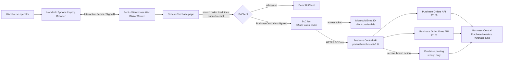

# Peritus Warehouse - BC

Blazor Server app (.NET 10) for handhelds, phones and laptops. Stores no data; everything is read from / posted to Business Central.

Run: `dotnet run --project src/PeritusWarehouse.Web`

Configure `BusinessCentral` in `appsettings.json` (use user-secrets for `ClientSecret`).
Without configuration the app runs against a demo client.

Processes: Receive purchase, Inventory count. Others are placeholders in the main menu.

## Architecture

The web app is stateless: it stores no business data. In configured mode, `BcClient`
uses the Entra client-credentials flow to call the custom Business Central API.
Otherwise, the app uses `DemoBcClient`. Receiving updates each positive line quantity
and then invokes the API's bound action, which posts the purchase receipt without
invoicing.

## BC extension (`al/`)

AL source files are grouped by object type under `al/src/` (`Pages`, `Tables`, `Codeunits`, `Enums`).
The Warehouse Worker WMS Role Center adds `Periodic`, `Data`, `Setup`, and an empty `User Manual` navigation group.

Custom API `peritus/warehouse/v1.0` (objects 91100-91299; change `idRanges` if they clash):
- `purchaseOrders` with bound action `Microsoft.NAV.receive` (posts receipt only, no invoice; order must be released)
- `purchaseOrderLines` (top-level, filter by `documentNumber`; item lines; `receiveQuantity` is writable and maps to Qty. to Receive)
- `inventoryCountBatches` (page 91103; item journal batches; `releasedToMobile` is the `Released To Mobile` field added by this extension's table extension 91100 / page extension 91104)
- `inventoryCountLines` (page 91102; Physical Inventory Journal lines; `countedQuantity` is writable and maps to Qty. (Phys. Inventory))

Put-away (`/putaway`), Pick (`/pick`) and Transfer (`/transfer`):
- Put-away and Pick list open warehouse activities (`putAways`, `picks`, pages 91105/91106). Lines come from `warehouseActivityLines` (page 91107); the worker sets *Qty. to Handle* per Take/Place line, then the bound action `register` registers the activity (codeunit 91108 runs `Whse.-Act.-Register`). Warehouse (not inventory) put-aways and picks are supported.
- Transfer lists released transfer orders (`transferOrders`, page 91109, actions `ship` and `receive`) with lines from `transferOrderLines` (page 91110). The worker toggles Ship/Receive, sets quantities and posts.

Item lookup (`/items`) searches items by number, barcode (GTIN) or name through the standard BC `items` API.

Inventory count lists all journals (item journal batches) in the template set by `BusinessCentral:CountTemplate` (default `PHYS. INVE`). Create lines with Calculate Inventory; the app records counts only, and posting the journal is done in BC.

Publish it to BC, then give the Entra app registration a BC permission set (e.g. `D365 BUS FULL ACCESS`, or narrower).

## Pick patterns

Set up in BC under *Pick Patterns* (objects 91120-91126). A warehouse shipment matches a pattern on location, shipment method include/exclude, zone (any line), max line length, total weight and volume (from item unit of measure Length/Weight/Cubage; 0 = unbounded). Lowest Priority wins when several patterns match. API: `pickPatterns` (with `availableCount`), `pickRequests` (POST creates the standard warehouse picks), `pickLines`, `pickBatches` (`release` action).

## Code element naming

Prefix AL code elements with `Peritus`.
