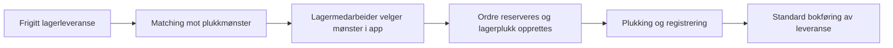

# Løsningsforslag: Pick Patterns (plukkmønstre)

**Løsning:** Peritus Warehouse for Microsoft Dynamics 365 Business Central
**Versjon:** 1.0

## 1. Bakgrunn og formål

Ved lagerplukking er det ønskelig at riktig type ordre plukkes sammen, av riktig person, på riktig måte. Ordre med lange varer, tunge varer eller bestemte fraktmetoder bør ikke blandes med standardordre.

Pick Patterns lar virksomheten definere regler (mønstre) for hvilke utgående lagerleveranser som skal plukkes sammen. Lagermedarbeideren velger et mønster i plukkapplikasjonen, og løsningen oppretter automatisk standard lagerplukk i Business Central for de ordrene som passer.

## 2. Løsningsoversikt

Løsningen består av:

- **Oppsett i Business Central:** Egen liste og kort for plukkmønstre.
- **Matchingslogikk:** Finner frigitte lagerleveranser som tilfredsstiller et mønster.
- **Integrasjon (API):** Plukkapplikasjon (f.eks. håndterminal/mobil) ber om plukk og henter plukklinjene.
- **Standard BC-funksjonalitet:** Selve plukkdokumentene er ordinære lagerplukk (Warehouse Pick), slik at registrering og bokføring følger standard prosess.

## 3. Oppsett av plukkmønster

Hvert plukkmønster har følgende egenskaper:

| Felt | Beskrivelse |
|---|---|
| Kode / Beskrivelse | Identifikasjon av mønsteret. |
| Aktiv | Inaktive mønstre kan ikke brukes til å opprette plukk. |
| Prioritet | Lavest tall vinner når en ordre passer til flere mønstre. Standard er 100. Ved lik prioritet vinner laveste kode. |
| Lokasjon | Lokasjonen mønsteret gjelder for. |
| Antall ordre | Maksimalt antall ordre som plukkes samlet. Færre plukkes hvis det ikke finnes nok tilgjengelige. |
| Beholdertype | Angir type plukkbeholder (fritekst), f.eks. kasse eller pall. |

### Filtre

| Filter | Virkemåte |
|---|---|
| Sonekode | Ordren kvalifiserer hvis minst én linje ligger i angitt sone. |
| Min./maks. lengde | Basert på lengste vare i ordren (lengde per grunnenhet fra varekortet). |
| Min./maks. vekt | Total vekt for gjenstående antall i ordren (vekt per grunnenhet fra varekortet). |
| Fra/til volum | Totalt volum for gjenstående antall (kubikk per grunnenhet fra varekortet). |
| Fraktmetoder | Liste over leveringsmåter som enten **inkluderes** eller **ekskluderes**. |

Regler for filtrene:

- Verdi 0 betyr «ingen grense».
- Er det ingen «Inkluder»-linjer på fraktmetoder, godtas alle fraktmetoder som ikke er eksplisitt ekskludert.
- Finnes det «Inkluder»-linjer, må ordrens fraktmetode være blant dem.
- «Ekskluder» har alltid forrang.

## 4. Hvilke ordre er tilgjengelige?

En lagerleveranse er tilgjengelig for et mønster når:

1. Leveransen er **frigitt** og tilhører mønsterets lokasjon.
2. Leveransen ikke allerede er reservert av en annen plukker.
3. Ingen av linjene har allerede opprettet plukk eller plukket antall.
4. Leveransen har minst én linje.
5. Fraktmetode, sone, lengde, vekt og volum tilfredsstiller mønsterets filtre.
6. Ingen **mønster med høyere prioritet** (lavere tall) på samme lokasjon passer for den samme ordren.

Ordre sorteres på leveringsdato slik at eldste ordre plukkes først. I mønsterlisten vises antall tilgjengelige ordre per mønster.

## 5. Prosess

1. **Forespørsel:** Plukkapplikasjonen sender en forespørsel med mønsterkode, operatør og en batch-ID.
2. **Reservasjon:** Inntil «Antall ordre» matchende leveranser merkes med batch-ID, mønsterkode, operatør og tidspunkt. Dette hindrer at andre plukker samme ordre.
3. **Plukkdokument:** Standard lagerplukk opprettes for hver leveranse og knyttes til batch-ID.
4. **Plukking:** Applikasjonen henter plukklinjene via batch-ID og registrerer plukket.
5. **Frigivelse:** Dersom plukket avbrytes, kan batchen frigis slik at ordrene igjen blir tilgjengelige.

Feilsituasjoner som håndteres:

- Mønsteret er inaktivt.
- Ingen ordre er tilgjengelig for mønsteret.
- Batch-ID mangler.

Opprettelsen utføres med tabelllås slik at to plukkere ikke kan få samme ordre ved samtidig forespørsel.

## 6. Integrasjon (API)

API-publisher `peritus`, gruppe `warehouse`, versjon `v1.0`.

| Endepunkt | Metode | Formål |
|---|---|---|
| `pickPatterns` | GET | Hent mønstre som kan velges i applikasjonen. |
| `pickRequests` | POST | Opprett plukk. Felt: `batchId`, `patternCode`, `operator`. |
| `pickBatches` | GET | Hent leveranser i en batch (`batchId`, `shipmentNumber`, `patternCode`, `pickedBy`). |
| `pickBatches` | Handling `release` | Frigi batchen og gjør ordrene tilgjengelige igjen. |
| `whseActivityLines` | GET | Hent plukklinjer, filtrert på batch-ID. |

## 7. Utvidelser av standard Business Central

- **Lagerleveransehode:** Felt for batch-ID, mønsterkode, plukket av og reservasjonstidspunkt.
- **Lageraktivitetslinje:** Felt for batch-ID, slik at plukklinjer kan hentes per batch.

Ingen standardlogikk endres. Løsningen bruker standard opprettelse av lagerplukk.

## 8. Eksempel

| Mønster | Prioritet | Filter | Antall ordre |
|---|---|---|---|
| LANG | 10 | Min. lengde 200 cm | 1 |
| EKSPRESS | 20 | Fraktmetode: Inkluder EKSPRESS | 5 |
| STANDARD | 100 | Ingen filtre | 10 |

En ordre med vare over 200 cm vil kun være tilgjengelig i «LANG», selv om den også passer «EKSPRESS» og «STANDARD», fordi «LANG» har høyest prioritet.

## 9. Forutsetninger og avgrensninger

- Lokasjon er satt opp med lagerstyring (lagerplukk og lagerleveranse).
- Vekt, lengde og kubikk er registrert på varekortets grunnenhet. Varer uten dette registrert bidrar med 0 i beregningene.
- Soner er opprettet på lokasjonen dersom sonefilter skal brukes.
- Løsningen oppretter og reserverer plukk. Rutesortering og plukkregistrering skjer i plukkapplikasjonen/standard BC.
- Demodata (lokasjon PWDEMO, varer, mønstre og leveranser) kan genereres fra mønsterlisten for test.

## 10. Testing og innføring

1. Opprett mønstre og filtre i testmiljø (eventuelt med demodata).
2. Verifiser antall tilgjengelige ordre per mønster mot forventning.
3. Test plukk via applikasjonen, inkludert frigivelse av batch og samtidige forespørsler.
4. Gjennomgå prioriteringer og filtre sammen med lagerpersonell.
5. Overfør oppsettet til produksjon.
